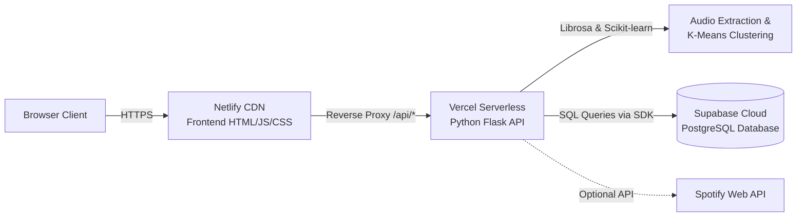

# 🚀 MusicMatch — Cloud Deployment Guide
## Netlify (Frontend) + Vercel (Backend Serverless) + Supabase (PostgreSQL)

This guide walks you through deploying **MusicMatch** completely to the cloud using modern serverless and cloud infrastructure:

| Component | Platform | Role |
| :--- | :--- | :--- |
| **Frontend** | **Netlify** | Global CDN hosting for HTML5, CSS3, Three.js, and PWA assets |
| **Backend** | **Vercel** | Serverless Python Flask runtime (`@vercel/python`) for audio feature mining & K-Means |
| **Database** | **Supabase** | Managed PostgreSQL replacing local SQLite completely |

---

## Architecture Flow



---

## Phase 1: Set Up Supabase Database (5 Minutes)

Supabase completely replaces the local SQLite (`musicmatch.db`) with a high-performance PostgreSQL instance.

### Step 1.1: Create a Supabase Project
1. Go to [https://supabase.com](https://supabase.com) and log in or create a free account.
2. Click **"New project"**.
3. Choose your organization, name the project `musicmatch`, set a secure database password, and pick the region closest to your users.
4. Wait ~2 minutes for the database to provision.

### Step 1.2: Execute Database Migration
1. In the Supabase Dashboard, click **"SQL Editor"** from the left navigation bar.
2. Click **"New query"**.
3. Open [`supabase_migration.sql`](./supabase_migration.sql) from the `musicmatch/` directory.
4. Copy the entire file content, paste it into the Supabase SQL Editor, and click **"Run"** (▶).
5. You should see `Success. No rows returned`.

This creates 5 structured tables:
- `sessions`: Analysis session tracker and user linkage
- `songs`: Extracted 18-D acoustic feature vectors (JSONB) and clustering assignments
- `similarity`: Pairwise cosine similarity matrix (JSONB)
- `users`: User authentication accounts (bcrypt-hashed passwords)
- `contact_messages`: Inquiries submitted via the contact form

### Step 1.3: Obtain API Credentials
1. Go to **Project Settings** (gear icon in the bottom left) → **API**.
2. Find and copy:
   - **Project URL** (e.g., `https://abcdefghijklmnopqrst.supabase.co`)
   - **`service_role` secret key** (under **Project API keys** — click *Reveal secret key*).
   > ⚠️ **Important:** Use the `service_role` key (not the `anon` key) for backend deployment. The backend requires full write access to manage sessions, songs, and users across RLS boundaries.

---

## Phase 2: Deploy Backend to Vercel (5 Minutes)

The backend is configured as a serverless Python WSGI application managed by Vercel via [`vercel.json`](./backend/vercel.json) and [`api/index.py`](./backend/api/index.py).

### Method A: Deploy via GitHub (Recommended)
1. Push your project to a GitHub repository:
   ```bash
   git add .
   git commit -m "feat: serverless cloud deployment configuration"
   git push origin main
   ```
2. Go to [https://vercel.com](https://vercel.com) and sign in.
3. Click **"Add New..."** → **"Project"**.
4. Import your GitHub repository.
5. In the configuration screen:
   - **Root Directory**: Click "Edit" and select `musicmatch/backend`
   - **Framework Preset**: Select **"Other"**
6. Expand **"Environment Variables"** and add:

   | Variable Name | Value | Description |
   | :--- | :--- | :--- |
   | `SUPABASE_URL` | `https://your-project-id.supabase.co` | Your Supabase Project URL |
   | `SUPABASE_KEY` | `eyJh...` | Your Supabase `service_role` key |
   | `JWT_SECRET` | `a_secure_random_32_char_string` | Secret key for JWT signing |
   | `CORS_ORIGINS` | `*` *(or your Netlify URL)* | Allowed frontend origins |
   | `SPOTIFY_CLIENT_ID` | *(optional)* | Spotify App Client ID |
   | `SPOTIFY_CLIENT_SECRET` | *(optional)* | Spotify App Client Secret |

7. Click **"Deploy"**.
8. Once deployment finishes, Vercel gives you an endpoint like:
   `https://musicmatch-backend-alpha.vercel.app`

### Method B: Deploy via Vercel CLI
If you prefer the command line:
```bash
# Install Vercel CLI if needed
npm install -g vercel

# Navigate to backend directory
cd musicmatch/backend

# Link and deploy
vercel

# Add environment variables
vercel env add SUPABASE_URL
vercel env add SUPABASE_KEY
vercel env add JWT_SECRET
vercel env add CORS_ORIGINS

# Deploy to production
vercel --prod
```

### Verify Backend Health
Test your live backend in a browser or terminal:
```bash
curl https://your-backend.vercel.app/api/health
```
You should receive:
```json
{
  "status": "ok",
  "app": "MusicMatch Audio Mining API v2 (Cloud Edition)",
  "features": "18-D (13 MFCCs + Tempo + Centroid + Chroma + ZCR + RMS)",
  "auth": "JWT enabled",
  "persistence": "Supabase PostgreSQL",
  "runtime": "Vercel Python Serverless"
}
```

---

## Phase 3: Deploy Frontend to Netlify (3 Minutes)

The frontend contains static HTML5, CSS3, JavaScript, WebGL Three.js shaders, and audio assets. Netlify will serve these globally with automated reverse-proxying to your Vercel backend.

### Step 3.1: Connect Frontend to Backend URL
Update the proxy target in [`musicmatch/frontend/_redirects`](./frontend/_redirects) and [`musicmatch/frontend/netlify.toml`](./frontend/netlify.toml):

In **`musicmatch/frontend/_redirects`**:
```text
/api/*  https://your-backend.vercel.app/api/:splat  200!
```
*(Replace `https://your-backend.vercel.app` with your actual Vercel URL from Phase 2)*

In **`musicmatch/frontend/netlify.toml`**:
```toml
[[redirects]]
  from = "/api/*"
  to = "https://your-backend.vercel.app/api/:splat"
  status = 200
  force = true
```

Commit and push these changes:
```bash
git add musicmatch/frontend/_redirects musicmatch/frontend/netlify.toml
git commit -m "chore: point Netlify proxy to live Vercel backend"
git push
```

### Step 3.2: Deploy on Netlify

#### Option 1: Git Integration (Recommended)
1. Go to [https://app.netlify.com](https://app.netlify.com) and sign in.
2. Click **"Add new site"** → **"Import an existing project"**.
3. Select your GitHub repository.
4. Configure Build settings:
   - **Base directory**: `musicmatch/frontend`
   - **Publish directory**: `.`
   - **Build command**: *(leave blank)*
5. Click **"Deploy site"**.
6. Netlify assigns you a live URL like: `https://musicmatch-demo.netlify.app`.

#### Option 2: Netlify Drop (Zero Setup)
1. In Netlify Dashboard, go to **Sites** → drag and drop the `musicmatch/frontend` folder.
2. Your site is live immediately!

---

## Phase 4: Verification & Smoke Testing Checklist

Run through these checks on your live Netlify site:

1. **System Health Check**:
   - Open browser DevTools (`F12`) → Console.
   - Navigate to the **Live Demo** page (`/demo.html`).
   - Confirm the status indicator says **"Connected to Cloud API"**.

2. **User Authentication**:
   - Click **"Sign Up"** in the top navigation.
   - Create a test account (e.g., username `clouduser`, password `password123`).
   - Confirm user profile loads and JWT token is stored in localStorage.
   - Check the `users` table in your Supabase dashboard to see the newly registered user.

3. **Audio Extraction & 18-D Mining**:
   - In `/demo.html`, click **"Load Synthetic Test Set"** (loads 5 pre-synthesized tracks) or drag-and-drop your own audio tracks.
   - Click **"Analyze Audio"**.
   - Verify:
     - 18 acoustic features are extracted.
     - K-Means clusters songs into distinct groups.
     - 2D PCA projection scatter plot renders.
     - Pairwise Cosine Similarity matrix is calculated.
     - Supabase `sessions` and `songs` tables reflect the new analysis.

4. **Session Persistence & Library Restore**:
   - Click **"Save to My Library"**.
   - Log out, then log back in.
   - Click **"My Library"** modal → verify previous session appears.
   - Click **"Restore"** → confirm all charts, vectors, and cluster tables reload instantly from Supabase.

5. **Contact Form**:
   - Go to `/contact.html`, fill out the form, and submit.
   - Check the `contact_messages` table in Supabase to confirm delivery.

---

## Summary of Completed Changes

- ✅ **Database**: Completely transitioned from SQLite to Supabase PostgreSQL via `supabase_migration.sql` and updated `backend/database.py`.
- ✅ **Serverless Backend**: Adapted `app.py`, created `api/index.py`, and configured `vercel.json` for Vercel's Python runtime. Ephemeral storage uses `/tmp`.
- ✅ **Frontend Proxy & Dynamic API**: Updated `main.js`, `auth.js`, and `demo.js` to automatically resolve `/api/*` seamlessly through Netlify's reverse proxy or direct CORS.
- ✅ **Security**: CORS headers, JWT authentication, bcrypt hashing, and Supabase RLS policies properly enforced.
