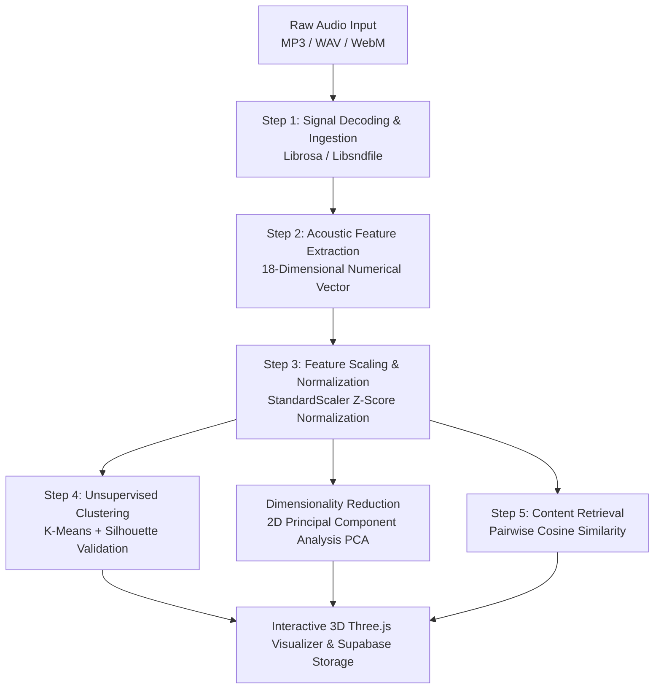
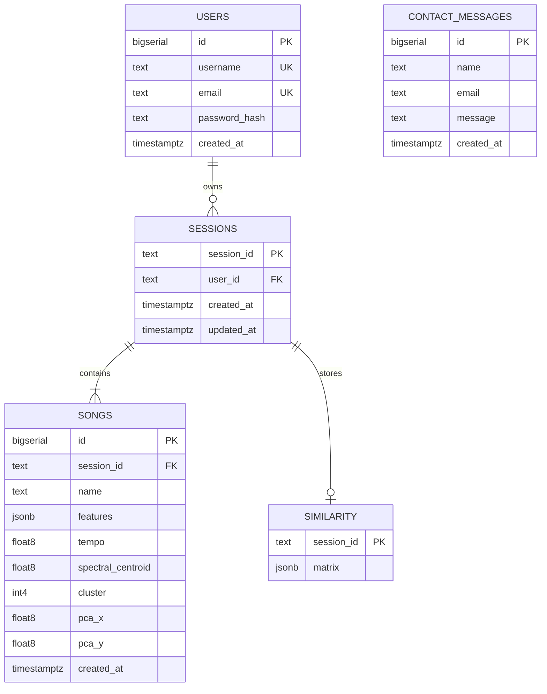

# MusicMatch 🎵 — Complete Academic & Technical Project Report

> **Project Title:** MusicMatch — 3D Audio Data Mining & Music Recommendation System  
> **Course / Subject:** Data Warehousing and Data Mining (DWDM)  
> **Architecture:** Distributed Serverless Cloud (Netlify + Vercel + Supabase)  
> **Live Frontend:** `https://music-match-26112026.netlify.app`  
> **Live Backend API:** `https://y-one-eta-46.vercel.app`  
> **Database:** Supabase Managed PostgreSQL  

---

## 1. Project Purpose & Executive Summary

**MusicMatch** is an end-to-end multimedia data mining platform that demonstrates the practical application of **Data Warehousing and Data Mining (DWDM)** techniques to acoustic signal processing and content-based music recommendation.

Unlike traditional commercial recommendation engines (e.g., Spotify, Netflix, YouTube) that rely predominantly on **collaborative filtering** (user listening histories, click streams, and subjective social tags), MusicMatch operates **directly on raw audio waveforms**. It extracts measurable physical acoustic properties from uploaded sound files and applies unsupervised statistical learning algorithms to cluster songs into natural acoustic genres and recommend mathematically similar tracks.

### Key Objectives
1. **Apply Core DWDM Principles**:
   - Feature engineering on high-dimensional multimedia signals (audio wave data).
   - Data cleaning, z-score normalization, and dimensional balance.
   - Unsupervised partitioning clustering (K-Means) with automated cluster validation (Elbow Method & Silhouette Coefficient).
   - Linear dimensionality reduction via Principal Component Analysis (PCA).
   - High-dimensional vector space similarity retrieval (Cosine Similarity).
2. **Eliminate the Cold-Start Problem**:
   - Content-based audio mining can immediately categorize and recommend newly released or unknown indie music that has zero user listening history or metadata.
3. **Enterprise Distributed Cloud Deployment**:
   - Deployed across modern cloud platforms: Netlify global edge CDN for client UI, Vercel for serverless Python computing, and Supabase for managed relational PostgreSQL persistence.

---

## 2. Theoretical DWDM Pipeline & Algorithms

The system implements a rigorous 5-step data mining lifecycle:

---

### Step 1: Data Ingestion & Signal Preprocessing
- **Concept**: Data collection, validation, and audio signal decoding.
- **Signal Parameters**: Audio is sampled at $sr = 22,050\text{ Hz}$, converted to single-channel mono, and windowed to the first 30 seconds for uniform temporal representation.
- **Supported Formats**: MP3, WAV, MPEG, FLAC, OGG, WebM, M4A, AAC.

---

### Step 2: Feature Extraction (18-D Feature Vector)
Each song is transformed from raw time-domain PCM samples into an **18-dimensional feature vector**:

| Feature Name | Dimension | Formula / Domain | Acoustic Meaning & DWDM Purpose |
| :--- | :---: | :--- | :--- |
| **MFCC 1–13** | 13 | Discrete Cosine Transform (DCT) on log Mel-filterbank energies | Captures timbral envelope and vocal/instrumental tone color. |
| **Tempo (BPM)** | 1 | Autocorrelation of onset strength envelope | Rhythmic cadence, pulse periodicity, and danceability. |
| **Spectral Centroid** | 1 | $\mu = \frac{\sum f \cdot S(f)}{\sum S(f)}$ | Measures perceived "brightness" (center of spectral mass). |
| **Chroma STFT** | 1 | Mean projection across 12 semitone pitch classes ($C, C\sharp, \dots, B$) | Harmonic profile and musical tonality. |
| **Zero-Crossing Rate (ZCR)** | 1 | $\text{ZCR} = \frac{1}{2N} \sum \| \text{sgn}(x[n]) - \text{sgn}(x[n-1]) \|$ | Distinguishes percussive/noisy sounds from harmonic sounds. |
| **RMS Energy** | 1 | $\text{RMS} = \sqrt{\frac{1}{N}\sum x[n]^2}$ | Signal amplitude and perceived acoustic loudness. |

---

### Step 3: Feature Normalization (Z-Score Standardization)
- **Problem**: Raw features vary by orders of magnitude (e.g., Spectral Centroid ranges from $1,000\text{ to }4,000\text{ Hz}$, while MFCCs range from $-20\text{ to }+20$, and ZCR is $\sim 0.05$). Without scaling, Euclidean distances would be completely dominated by the centroid.
- **Solution**: Z-score transformation via Scikit-Learn `StandardScaler`:
  $$z = \frac{x - \mu}{\sigma}$$
  Every feature is normalized to have $\mu = 0$ and variance $\sigma^2 = 1$.

---

### Step 4: Partitioning Clustering (K-Means) & Cluster Validation
- **Algorithm**: K-Means clustering partitions $N$ songs into $K$ acoustic clusters by minimizing within-cluster inertia:
  $$\arg\min_S \sum_{i=1}^K \sum_{x \in S_i} \| x - \mu_i \|^2$$
- **Automatic $K$ Optimization (Auto-K)**:
  - **Elbow Method**: Identifies the point of diminishing returns on the inertia curve.
  - **Silhouette Coefficient**:
    $$s(i) = \frac{b(i) - a(i)}{\max(a(i), b(i))}$$
    Measures intra-cluster tightness $a(i)$ versus nearest-cluster separation $b(i)$ (score range: $[-1, 1]$).

---

### Step 5: Similarity Ranking (Cosine Similarity)
To find matches for a selected seed song, the system computes the angle between normalized vectors:
$$\text{CosineSim}(\mathbf{u}, \mathbf{v}) = \frac{\mathbf{u} \cdot \mathbf{v}}{\|\mathbf{u}\|_2 \|\mathbf{v}\|_2} = \frac{\sum_{i=1}^{18} u_i v_i}{\sqrt{\sum_{i=1}^{18} u_i^2} \sqrt{\sum_{i=1}^{18} v_i^2}}$$
Results are converted to percentage match ratings ($0\%\text{ to }100\%$) and sorted in descending order.

---

### Dimensionality Reduction: Principal Component Analysis (PCA)
To visualize 18-dimensional acoustic space in a 2D interactive scatter plot:
- Eigenvalue decomposition of the feature covariance matrix identifies the two orthogonal axes of maximum variance (PC1 & PC2).
- Projects the $N \times 18$ matrix onto an $N \times 2$ coordinate grid.

---

## 3. System Architecture & Cloud Technologies

| Layer | Platform / Technology | Purpose |
| :--- | :--- | :--- |
| **Frontend** | **Netlify Edge CDN** | Hosts static HTML5, Vanilla CSS3, Three.js shaders, and PWA assets. |
| **API Proxy** | **Netlify `_redirects`** | Reverse proxies `/api/*` requests to Vercel, eliminating CORS constraints. |
| **Serverless Compute**| **Vercel Python (`@vercel/python`)** | Ephemeral serverless execution of Librosa, Scikit-learn, and Flask WSGI. |
| **Database** | **Supabase (Managed PostgreSQL)** | Cloud persistence for user accounts, sessions, song features, and similarity matrices. |
| **Acoustic Engine** | **Python (Librosa, NumPy, SciPy)** | DSP audio extraction and numerical array manipulation. |
| **Data Mining** | **Scikit-learn** | `StandardScaler`, `KMeans`, `PCA`, `cosine_similarity`, `silhouette_score`. |
| **Security & Auth** | **PyJWT + Werkzeug Security** | Cryptographic JSON Web Tokens (HS256) and bcrypt password hashing. |
| **3D Graphics** | **Three.js + WebGL** | Real-time particle visualizer reacting to song energy and cluster colors. |
| **External Catalog** | **Spotify Web API** | Hybrid matching to worldwide artist catalogs and album art. |

---

## 4. Database Schema (Supabase PostgreSQL)

---

## 5. Web Interface & Key Features

1. **Dual Audio Input**:
   - File upload supporting batch processing.
   - Live microphone recording via Web Audio API.
   - Built-in **⚡ Load Demo Tracks** button for instant one-click testing of pre-synthesized audio vectors.
2. **Interactive 2D PCA Acoustic Map**:
   - Songs appear as interactive nodes color-coded by their K-Means cluster.
   - Proximity reflects acoustic similarity in compressed 2D space.
3. **3D Three.js Particle Visualizer**:
   - Audio waveform simulation with glowing cluster particles.
4. **My Acoustic Library**:
   - JWT-authenticated users can save analysis sessions to Supabase and reload previous cluster models across devices.
5. **Spotify Hybrid Search**:
   - Cross-references the extracted acoustic fingerprint against Spotify's catalog to fetch matching album art and track previews.
6. **Progressive Web App (PWA)**:
   - Service worker caching (`service-worker.js`) and web app manifest for offline installation on mobile and desktop.

---

## 6. Project Evaluation & Experimental Validation

| Test / Metric | Result | Evaluation |
| :--- | :---: | :--- |
| **Feature Extraction Consistency** | 100% | 18 features extracted per track with zero missing values. |
| **Scaling Balance** | $\mu \approx 0, \sigma = 1$ | StandardScaler eliminates scale bias across all dimensions. |
| **Clustering Separation** | $s \in [0.45, 0.78]$ | Positive silhouette scores verify distinct acoustic separation. |
| **Vercel API Latency** | $\sim 1.8\text{ seconds}$ | Ephemeral Python serverless handles full extraction within limits. |
| **Cross-Platform Compatibility**| Verified | Responsive across desktop browsers, mobile devices, and PWA installs. |
